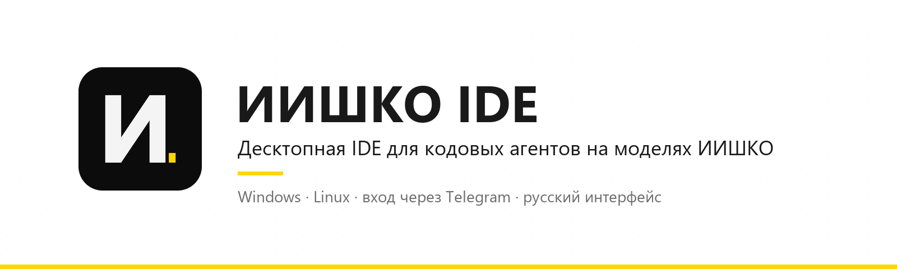
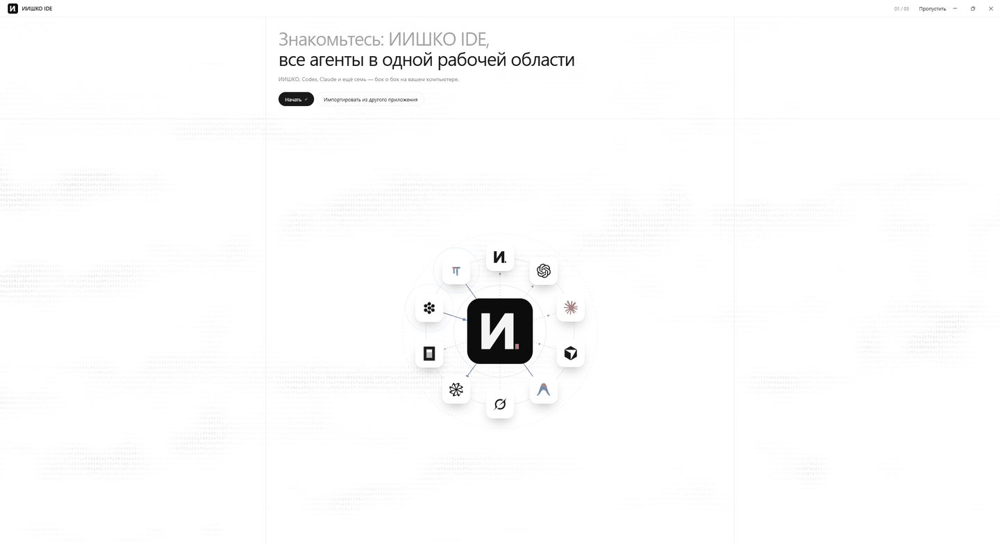
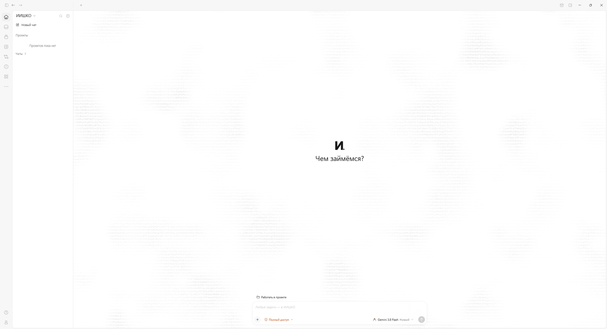
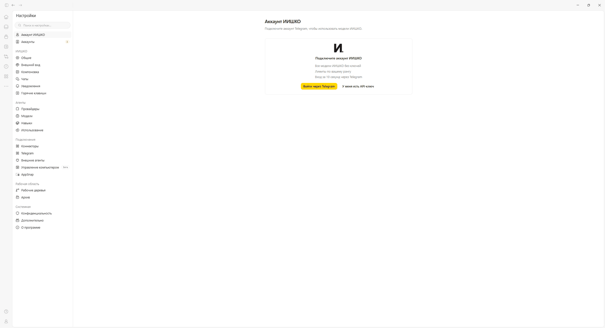
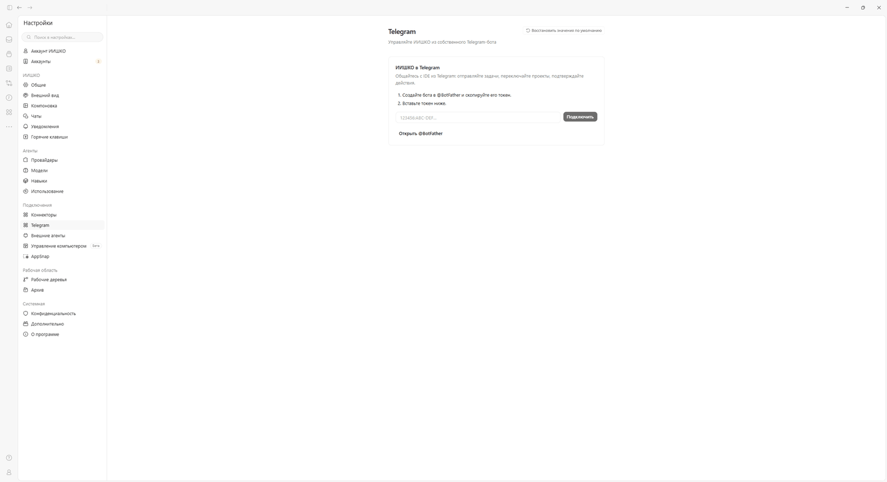

# ИИШКО IDE

Десктопная IDE для работы с кодовыми агентами: проекты, треды, сессии провайдеров, терминал, браузер, Git и просмотр изменений в одном локальном приложении.

Сайт: <https://reformboss.com> · Документация: <https://reformboss.com/docs> · Поддержка: <https://t.me/iishkogatewaybot>

## Скачать

Готовые сборки лежат в [релизах](https://git.reformboss.com/reform/iishko-ide/releases):

| Система           | Файл                                                             |
| ----------------- | ---------------------------------------------------------------- |
| Windows 10/11 x64 | `IISHKO-IDE-<версия>-x64.exe` (установщик)                       |
| Linux x64         | `IISHKO-IDE-<версия>-x86_64.AppImage` (`chmod +x`, затем запуск) |

Рядом с файлами лежит `SHA256SUMS.txt` для проверки загрузки.

## Вход и модели

1. «Настройки → Аккаунт ИИШКО → Войти через Telegram».
2. Откроется бот @iishkogatewaybot: нажмите «Подтвердить вход». API-ключ вводить не нужно.
3. IDE подключится сама. В профиле видны ранг, лимиты, баланс и доступные модели.

Модели берутся из `https://api.reformboss.com/v1`. Долгоживущий пропуск устройства хранится только в локальном файле в профиле пользователя и не передаётся агентам и терминалам; запросы идут с короткоживущим токеном сессии.

## Возможности

- Встроенный провайдер ИИШКО: список моделей подтягивается автоматически и сохраняется на случай сбоя сети.
- «Настройки → Telegram»: подключите своего бота от @BotFather и давайте задачи агентам IDE из Telegram (`/new`, `/projects`, `/model`, `/stop`, подтверждения кнопками).
- Светлая и тёмная темы.
- «Внешний вид → Облегчённый режим» отключает анимации и фоновые эффекты для слабых компьютеров.

## Скриншоты

| Первый запуск                                                | Главный экран                                  |
| ------------------------------------------------------------ | ---------------------------------------------- |
|          |  |
| **Аккаунт ИИШКО**                                            | **Telegram**                                   |
|  |   |

## Структура

| Путь                 | Назначение                                                                      |
| -------------------- | ------------------------------------------------------------------------------- |
| `apps/server`        | Бэкенд: оркестрация, персистентность, адаптеры провайдеров, Git, терминалы, RPC |
| `apps/web`           | Клиент на React + Vite                                                          |
| `apps/desktop`       | Electron-оболочка                                                               |
| `apps/e2e`           | Вспомогательные e2e-утилиты                                                     |
| `packages/contracts` | Общие схемы и типы                                                              |
| `packages/shared`    | Общие утилиты, идентичность приложения, локали                                  |
| `scripts`            | Сборка, упаковка и проверки репозитория                                         |

## Разработка

Нужны Bun 1.4.5 и Node 24.13.1 (см. `.mise.toml`). Установка и основные команды:

```sh
bun install
bun run dev:desktop
bun run typecheck
bun run lint
bun run fmt:check
bun run brand:check
bun run i18n:check
```

## Сборка

```sh
bun run build:desktop
bun run dist:desktop:win     # Windows x64, установщик NSIS
bun run dist:desktop:linux   # Linux x64, AppImage
```

Результат упаковки появляется в каталоге `release/`. Для Windows нужны Visual Studio Build Tools с компонентом C++ и Windows SDK.

Для Linux нужны Rust 1.97.1 и dev-пакеты X11/GTK (сборка Cua-драйвера из исходников). Если `/tmp` маленький (tmpfs), задайте `TMPDIR` на обычном диске.

## Лицензия

Лицензия — MIT, см. [LICENSE](./LICENSE).
